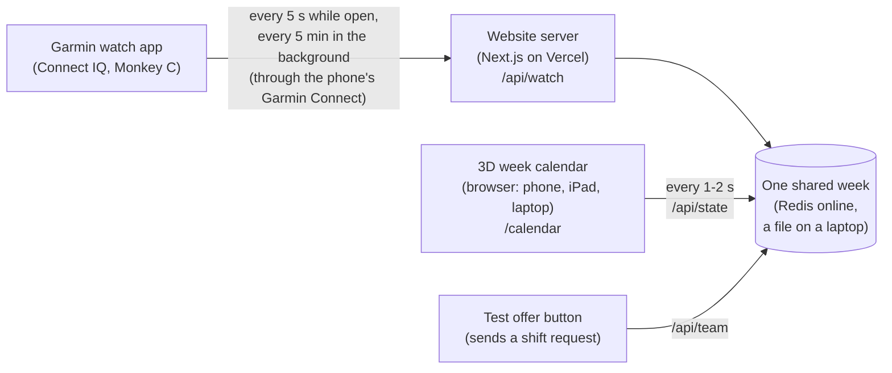
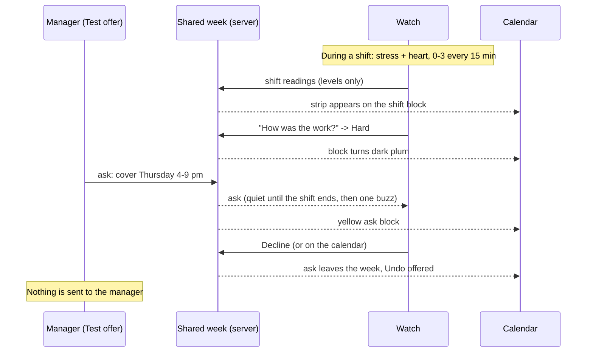

# How the Offshift prototype works, step by step

Offshift helps university students who work casual shifts answer a manager's shift request ("can you cover tonight?") on their own terms. It is two parts that share one week:

1. **A Garmin watch app** (fēnix 8, 47 mm). After each shift it asks one question, "How was the work?". During shifts it reads stress and heart rate as simple levels. When a shift request arrives, it shows it with context and lets you answer with one press.
2. **A website with a 3D week calendar** (https://offshift-nine.vercel.app). It shows your shifts, classes and plans as blocks, each shift with a strip of 15-minute readings, and the shift request with your past shifts at that workplace.

Nothing is ever sent to the employer. Offshift never gives advice or a diagnosis. You decide.

All pictures below are real screens from the prototype.

---

## The whole system on one page

- There is **one shared week** per server. The watch and every open calendar read and change the same week, so an answer on the wrist shows up on the calendar within a few seconds, and the other way round.
- The watch has no internet of its own: it goes online through the phone's Garmin Connect app over Bluetooth.
- The exhibition demo has a **second, separate week** (see "The three pages" below), so visitors never touch a participant's data.

---

## The loop, step by step

### Step 1: Put your week in the calendar

Your shifts (violet), classes (blue) and personal plans (coral) go into the 3D week. Days are columns of tiles, time of day is height, and each event is a block standing on its day.

### Step 2: Work the shift; the watch reads your body

With sharing turned on, the watch reads **stress** (from heart-rate variability) and **heart rate** during rostered shifts only, never the rest of your day. It keeps the raw numbers on the wrist and sends only a level from 0 to 3 for every 15 minutes: stress is resting, low, medium or high; heart is very light, light, moderate or vigorous.

The calendar draws these levels as a strip down the front of the shift block: pale mint means calm, deep navy means high. A striped cell means "no reading" (for example when big movements made the watch drop data).

### Step 3: After the shift, one question on the watch

About 15 minutes after the shift ends (up to 12 hours later), the watch asks **"How was the work?"** with four words and a skip:

| Answer | Second line on the watch |
|---|---|
| Light | Less than usual |
| Steady | A normal shift |
| Busy | Fast, lots to do |
| Hard | Asked a lot of you |
| Skip | Not this time |

One press saves it. The shift block turns from pale lilac (Light) to dark plum (Hard).

### Step 4: A manager sends a shift request

A request ("ask") arrives, for example "Sam - Cafe · Cover Thursday? · 4-9 pm". In the prototype it comes from the calendar's **Test offer** button (standing in for a manager).

- **If you are not on a shift**, the watch buzzes straight away.
- **If you are on a shift**, the watch stays quiet ("Quiet until 10 pm") and buzzes **once** when the shift ends, with "Sam asked you to cover Thursday, 4-9 pm. Open Offshift?". This came from our usability tester: watches aren't allowed on the register, so a buzz mid-shift only adds pressure.
- **An ask that starts before your shift ends** (stay back tonight) still buzzes at once, because it can't wait.

### Step 5: See the context before you answer

On the watch, the next page ("Around it") shows how your **last shifts at that workplace** went ("Last 2 at Cafe: Hard, Busy") and how the ask fits the week ("7pm clash: Study", "Fri starts 9am").

On the calendar, the ask is a glowing yellow block. Opening it shows:

- **Body**: what your readings say about the days around it, in words.
- **Week**: clashes, the gap before, and the next morning's start.
- **Past shifts**: small repeated cards of your last shifts at that workplace, each with your word and its stress and heart bars.

### Step 6: Answer on your terms

Three answers, on the watch or the calendar:

- **Accept**: the shift goes onto your week.
- **Decline**: the ask comes off your week.
- **Decide later**: it stays on the week, see-through, and only you can see you're deciding.

**No answer sends the manager a message.** You tell them yourself. The calendar offers **Undo**.

Then the loop starts again with the next shift.

---

## The three pages

| Page | What it is | Which week |
|---|---|---|
| `/calendar` | The real prototype for a participant | The participant's week |
| `/demo` | The exhibition demo. Opening it starts a fresh scenario | Its own demo week |
| `/field-testing` | Field test F1's week, read only, with what his watch showed | A fixed copy, never saved |

### `/demo`, the exhibition demo

Opening https://offshift-nine.vercel.app/demo resets the demo week to this scenario, built around the moment you open it. It was designed for the exhibition, 10 am to 2 pm on Thursday 29 October 2026, when the shift that just ended is a morning one, but it works whenever it opens:

- A 4-hour Cafe shift ended about 20 minutes ago with stress mostly high, so the watch asks "How was the work?". The watch's Last shift page shows the same shift, with the calendar's times.
- Three earlier Cafe shifts were Steady and Busy (last week) and Hard (two days ago).
- The same classes and plans repeat last week, this week and next week: lectures on Monday, Tuesday and Friday, a Wednesday tutorial, a Thursday practical, the gym on Saturday and a call home on Sunday. Shifts don't repeat, and next week has none.
- Sam asks to cover **tonight**, 5-10 pm (or tomorrow evening once it's after 4 pm). It clashes with "Study for the assignment" at 7 pm, and the next day starts with a 9 am lecture.

The **demo watch build** reads this demo week (its address is `https://offshift-nine.vercel.app/demo`), so answering on the watch updates the page within seconds. **Restart** in the bar at the top starts the scenario over for the next visitor.

**Running it at the exhibition:**

1. Install the demo watch build on the watch (it replaces the normal app; put the normal one back afterwards).
2. Keep the phone near the watch with Bluetooth on and Garmin Connect open.
3. Open `/demo` on one screen only (opening it again resets the demo for everyone).
4. Open Offshift on the watch: rate the shift, then answer Sam's ask. Watch the page update.
5. Press **Restart** before the next visitor.

### `/field-testing`, the field test week

One fast-food worker used Offshift for a week (19-25 October 2026): three Burger bar shifts, classes on Tuesday and Thursday, and a coding demo on Friday. The page shows his week in 3D with his ratings and readings, and below it every watch screen in time order (check-ins, two asks, his two declines, Sunday's shift read back in words). The 15-minute readings are a reconstruction from what he described, not the raw watch data, and names are changed.

---

## Rules the prototype keeps

- **Nothing goes to the employer.** No answer sends a message; body readings, plans and private notes never reach the team view.
- **Words, not scores.** Readings are four levels per 15 minutes, never raw heart rate or a stress score.
- **Only during shifts.** The watch reads stress and heart rate only on rostered shifts, and only with sharing on. Turning sharing off clears the readings.
- **No diagnosis, no advice.** Offshift describes; the worker decides.
- **Quiet while you work.** A new ask waits until the shift ends.
- **Undo.** Every change on the calendar can be undone.

---

## Where things are in the code

| Part | Where | What it does |
|---|---|---|
| Calendar website | `offshift-phone/` (Next.js 16, Three.js) | `/calendar`, `/demo`, `/field-testing`, `/access` |
| 3D week | `offshift-phone/src/components/board/Week3D.tsx` | The blocks, strips and labels |
| Shared week on the server | `offshift-phone/src/lib/server-state.ts` | Redis online, a file on a laptop; a separate demo week |
| API | `offshift-phone/src/lib/api-routes.ts` | `/api/state` (calendar), `/api/watch` (watch), `/api/team` (asks); the same under `/api/demo` |
| What the watch shows | `offshift-phone/src/lib/garmin.ts` | Builds the watch's text: the ask, its week lines, past shifts, check-in |
| Quiet while you work | `offshift-phone/src/lib/quiet.ts` | Holds a new ask until the shift ends |
| Readings | `offshift-phone/src/lib/shift-body.ts` | Levels, colours, sentences like "Stress mostly high" |
| Watch app | `offshift-watch/source/*.mc` (Monkey C) | Check-in, ask pages, answers, readings, background checks |
| Design reasons and sources | `docs/design/`, and the team's testing document (tab 5) | Why each choice was made, with research |

**Run it on a laptop** (from `offshift-phone/`): `npm install`, then `npm run dev`, then open the printed address. Tests: `npm test` (260 tests), `npm run typecheck`, `npm run build`.

DECO2850 Design Computing Studio 2 · The University of Queensland · 2026 · Team Tarzan
