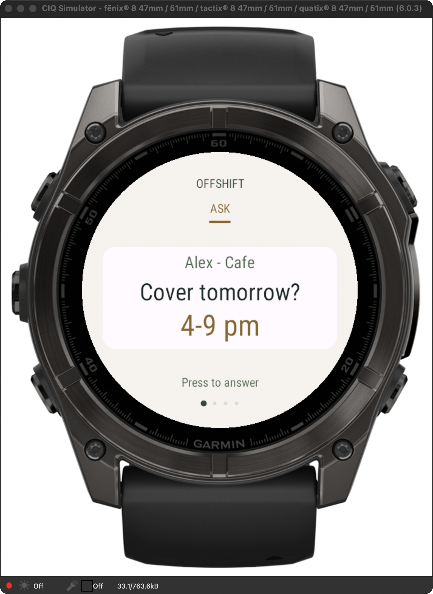

# Weekly contribution — Garmin UI and cloud connection

**Contributor:** Andhika Nayaka Arya Wibowo (`AndhikaNayakaAW`)
**Week:** 19–25 October 2026 · Australia/Brisbane
**Recorded:** 19 October 2026
**Starting point:** teammate release `bcfbc85`

## Contribution narrative

I pulled the latest team implementation and extended the existing native Garmin application for the confirmed fēnix 8 47mm. My teammate had already implemented the native app, sensor mapping, dated calendar, team session controls, access-code support and Redis-compatible server. My contribution focused on making the watch UI consistent with the calendar, preparing a reliable private cloud build, configuring the deployment and documenting evidence. I preserved the teammate's authorship and the existing unrelated lockfile edit. Implementation, test execution and documentation were assisted by Codex.

I changed the four watch pages to use the calendar's cream background, forest-green text, warm accent and paper cards. Cached vector fonts establish a clearer hierarchy while keeping long names and times inside the circular display. Page indicators show the position in the four-page flow, and the answer and sharing menus use Garmin's green theme. I also updated the glance and shortened the first-run consent prompt after simulator review showed the original wording was truncated. The browser `/watch` caption now distinguishes its file-import preview from Garmin synchronization on the calendar.

I replaced laptop-oriented release defaults with a production HTTPS build workflow. The builder validates the site address, normalizes links such as `/calendar`, accepts a private access-code file and supports explicit HTTP loopback simulation. It prepares temporary source and resources, embeds the selected endpoint there, prints only the public origin and removes the temporary files afterward. The signing key and private environment stay outside Git; the ignored watch binary has owner-only permissions. During simulator testing I discovered that Garmin retained the old `baseUrl` property after a sideload. I reproduced that problem in a native regression, then made the installed build use its compiled endpoint independently of that retained setting.

I configured the existing Vercel project with an Upstash Redis database named `offshift-week` on the free plan, with automatic paid upgrades and the production add-on disabled. I connected it to Production and configured a private shared access code as a Vercel secret. The existing server's compare-and-set storage can now synchronize the calendar, team page and watch across Vercel instances. The deployed route is watch → paired phone running Garmin Connect → internet → Vercel → Redis. After installation this architecture does not require the laptop or a tunnel; the paired phone and internet connection are still needed for the communication bridge.

I used five observed red/green cycles. These covered secure build configuration, readable watch theming, sync status and explicit confirmation, and migration away from retained laptop settings. The sync regression also fixed a case where a successful reply left an old offline message on screen. Safety tests verify that cancelling sends nothing, a confirmed reply sends the chosen decision, and a failed send retains the ask and last successful sync. The physiological thresholds from the teammate's implementation were not changed.

I added a final build-safety regression after checking the real compiler output. Garmin writes intermediate MIR files containing deployment constants beside its output, so the builder now keeps compilation entirely inside its private temporary directory and publishes only the program and symbol file with owner-only access after success. Two new integration tests reproduce intermediate leakage and a failed compiler replacing a working binary; both pass with the fix. This also removes the sensitive intermediates left by earlier local builds.

The first eight commits were pushed together, and GitHub validation passed. That Git push automatically deployed the web app to Vercel. I then ran 17 synthetic checks against the live protected API: unauthorized requests were rejected; browser login set a secure HttpOnly cookie; storage reported Redis; a team ask reached the protected watch route; two simultaneous accept requests produced one success and one conflict; and the calendar contained exactly one resulting shift. I also verified synthetic health-band delivery, omission of health and plans from the team response, and deletion when sharing was switched off. I cleared the synthetic session to an empty week afterward.

I updated the wiki's home page, getting-started guide, architecture, deployment instructions, watch/reflection guide, testing guide and weekly contribution record. The new instructions use the actual current routes: `/calendar` is the dated 3D week and `?view=day` opens daily reflection. They distinguish the native shared band data from the browser-only numeric import and reflection store. Earlier September phone/demo claims are now identified as course history rather than current behavior.

## Commit evidence

| Commit | Phase | Change |
| :--- | :--- | :--- |
| [`386fc01`](https://github.com/AndhikaNayakaAW/DECO2850-team-project/commit/386fc01) | Red | Define HTTPS, URL normalization and private endpoint contracts; six failures and one passing guard. |
| [`1ef216c`](https://github.com/AndhikaNayakaAW/DECO2850-team-project/commit/1ef216c) | Green | Implement the release builder and production defaults; all seven build contracts pass. |
| [`65eb9dc`](https://github.com/AndhikaNayakaAW/DECO2850-team-project/commit/65eb9dc) | Red | Add native ground, branding and contrast assertions; three new failures. |
| [`13725fe`](https://github.com/AndhikaNayakaAW/DECO2850-team-project/commit/13725fe) | Green | Apply the calendar theme, cached vector type, paper cards, native green menus and page indicators; 18 native tests pass. |
| [`2766f73`](https://github.com/AndhikaNayakaAW/DECO2850-team-project/commit/2766f73) | Red | Reproduce stale offline status and an opaque access error; 21 tests pass and two fail. |
| [`3db074d`](https://github.com/AndhikaNayakaAW/DECO2850-team-project/commit/3db074d) | Green | Clear stale status after a successful reply and explain access failures; 23 native tests pass. |
| [`6d45f43`](https://github.com/AndhikaNayakaAW/DECO2850-team-project/commit/6d45f43) | Red | Reproduce a retained laptop URL overriding an updated sideload. |
| [`8b67263`](https://github.com/AndhikaNayakaAW/DECO2850-team-project/commit/8b67263) | Green | Embed the build endpoint independently of retained settings; all 24 native tests pass. |
| [`89420fd`](https://github.com/AndhikaNayakaAW/DECO2850-team-project/commit/89420fd) | UI refinement | Shorten consent text, match the glance to the calendar and clarify the browser preview boundary. |
| [`e9c0423`](https://github.com/AndhikaNayakaAW/DECO2850-team-project/commit/e9c0423) | Documentation | Publish the initial Garmin report, verification evidence and current wiki. |
| [`f9d357b`](https://github.com/AndhikaNayakaAW/DECO2850-team-project/commit/f9d357b) | Red | Reproduce private compiler intermediates and a failed build overwriting the working release; two new tests fail. |
| [`d9021c1`](https://github.com/AndhikaNayakaAW/DECO2850-team-project/commit/d9021c1) | Green | Keep compiler intermediates private and publish the release only after success; all nine build tests pass. |
| [`4c6b0d1`](https://github.com/AndhikaNayakaAW/DECO2850-team-project/commit/4c6b0d1) | Documentation | Record the fifth TDD cycle, cloud persistence proof and device-installation status at that point. |

The accompanying documentation commit records this report, native simulator screenshot, raw native test output, production-check results and wiki source. Its hash and the separate wiki publication hash are recorded in Git history and the handoff message; they are not invented in advance.

## Interaction and data flow

The researcher starts a session and sends an ask from `/team`. The worker sees that ask on the calendar and on the watch's Ask page, then can inspect the surrounding week and optional body words. They choose one of five responses. A reply reaches the server only through the confirmation path; deciding later sets a reminder without a manager message. Accepting creates a shift in the calendar, while the team page sees the response. A failed reply remains available to retry.

Body sharing is optional. Raw values remain on the watch, while the server receives timestamped bands encoded 0–3 and displays words. Sharing-off removes the shared wearable record. The team projection excludes the worker's body data and private plans. This is still one shared session behind one code, without separate participant accounts or employer/worker API roles; the team screen's restricted response is not a claim of full role isolation.

The circular browser `/watch` preview is a separate interaction study. It accepts explicitly loaded synthetic readings or unverified file imports, and its numeric readings, reflections and confirmed recovery blocks remain in browser storage. It does not pair with the physical watch. A physiological reading does not establish stress, tiredness caused by work or a clinically meaningful conclusion. The proposed reflection focus and any reduction in stress still require worker evaluation.

## Verification evidence

| Check | Observed result |
| :--- | :--- |
| Web tests | 200 tests across 20 files passed. |
| TypeScript and production build | Both passed; current app routes generated successfully. |
| Native simulator | 24 tests passed on the `fenix847mm` profile. |
| Build configuration | All 9 Node contracts passed; included in GitHub Actions. |
| Standalone prototype | Existing logic check passed. |
| Live production API | 17 synthetic checks passed; test session cleared. |
| GitHub CI after first push | [Successful run](https://github.com/AndhikaNayakaAW/DECO2850-team-project/actions/runs/39259454484). |
| Automatic production deployment | [Successful deployment](https://vercel.com/andhikanayakaaws-projects/offshift/E716bF3huNfhVXS4pnwA3jcwNNhB) of `8b67263`. |
| Native visual review | Refreshed Ask page inspected in Garmin's simulator with an isolated practice session. |
| Physical installation | Installed on the actual fēnix 8 47mm; MTP readback exactly matches the compiled release. Owner confirms the app opens. |
| Physical internet connection | Pending: app reports Phone not connected; paired-phone bridge is being checked. |

[Native simulator output](assets/garmin-native-tests-2026-10-19.txt) · [Production check record](assets/garmin-production-verification-2026-10-19.json)

*Simulator capture using a synthetic Alex/Cafe ask. It is not a photograph of the physical watch and does not prove real sensor delivery.*

## Final deployment verification

The subsequent documentation/UI push `e9c0423` also passed [GitHub validation](https://github.com/AndhikaNayakaAW/DECO2850-team-project/actions/runs/39260753928) and [automatically deployed](https://vercel.com/andhikanayakaaws-projects/offshift/73VJfqbzaBbNTcfpFLwJuzVYM5GX). The same Redis snapshot and version survived that redeployment unchanged; the calendar, daily view, browser watch and team routes returned HTTP 200 after authentication. The initial wiki publication is `958811d`.

The build-safety fix and updated record were also released in `4c6b0d1`, with [successful GitHub validation](https://github.com/AndhikaNayakaAW/DECO2850-team-project/actions/runs/39262276937) and an [automatic Vercel deployment](https://vercel.com/andhikanayakaaws-projects/offshift/H2ug6pSPhqieoTcBYP3Zya8de3Yt). The second wiki publication is `3e250af`.

## Physical installation and remaining connection check

The initial USB connection was intermittent, but MTP became stable after reconnecting. The device identified itself as a fēnix 8 47mm with software 23.40. The visible `GARMIN/Apps` listing exposed no PRG, so the file was added without deleting a visible program. A 20 October check found the same empty listing while Offshift was running; therefore the listing does not establish whether an app was already installed. I saved the directory listing privately and left the existing folders and `OUT.BIN` unchanged.

I installed the protected `OFFSHIFT.PRG`, downloaded the installed file back from the watch and compared SHA-256 hashes. Both hashes matched exactly for the 37,420-byte release. The owner then unplugged the watch, opened Offshift and confirmed that it launches. [Installation and readback record](assets/garmin-install-verification-2026-10-19.json).

The app currently reports “Phone not connected.” The owner says Garmin Connect shows the watch as connected and confirmed that reopening Offshift with Garmin Connect open did not resolve the message. This is the app's mapping of Garmin's `BLE_CONNECTION_UNAVAILABLE` (`-104`), rather than an HTTP access-code or Vercel error. The owner also reported a saved shift in the glance and “No reading” on the Body page. The glance reads persisted app storage, so that text does not prove a fresh request; missing sensor values remain unavailable rather than being replaced with demo readings.

The owner subsequently clarified that the watch is paired with another person's phone, which is leaving and will not be available for the test. This identifies a missing dependency in the installed app's phone-based route; seeing that phone's connected indicator was not evidence of an available communication bridge here. The Mac's USB installation connection cannot substitute for Garmin Connect Mobile. Pairing an available phone through Garmin Connect is the direct next step. Garmin also exposes a separate Wi-Fi sync mode for this model, but that feature is not implemented in this installed release.

No new watch request has yet reached Vercel after installation. The server observation checks `/api/state` without calling the watch endpoint, and the simulator is stopped, so the observation does not create its own watch-contact timestamp. Physical installation and launch are verified, while actual phone-to-Vercel sync, real sensor delivery and an on-wrist reply remain unverified. The earlier live API and simulator checks are separate evidence, and development tools do not provide remote screen control of the physical watch.

The next runtime check is a new watch contact timestamp after opening the installed app, followed by an ask and an explicitly confirmed reply. Check real body delivery only if the wearer chooses to share it. Worker evaluation and comfort on the wrist remain separate from technical tests.
