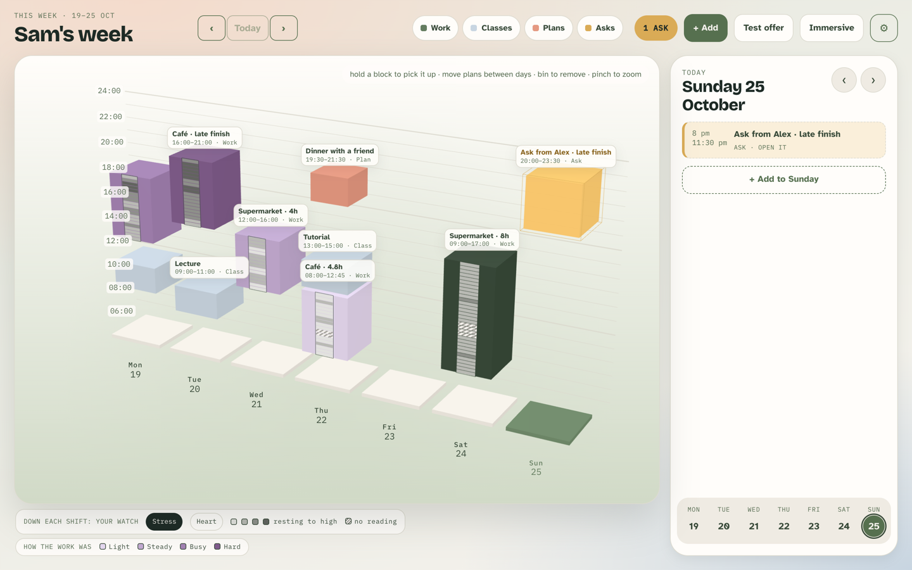
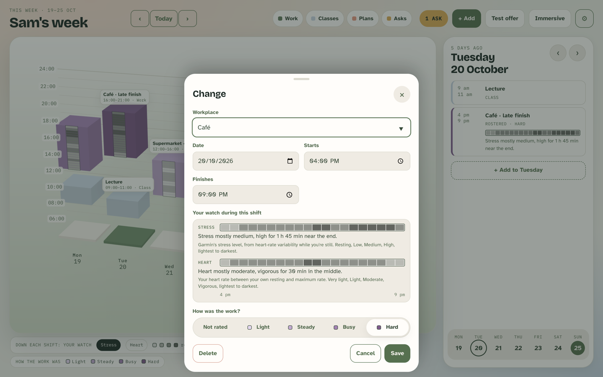
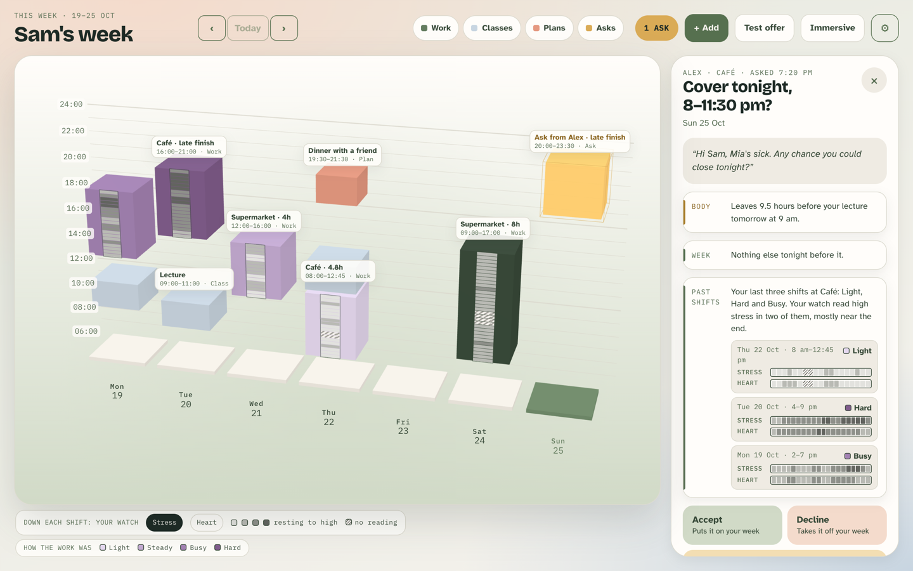

# Design rationale: heart rate and stress during each shift

Offshift, DECO2850, Iteration 5, 25 October 2026.

This document explains why Offshift now reads the body only during shifts, and how that reading reaches the calendar and the next shift ask. It also covers:

- how the decisions link to our interviews (P1–P5);
- how we would answer the tutor's three questions;
- the user tests still to run.

It builds on the 23 October rationale for the check-in ([2026-10-23-shift-check-in.md](2026-10-23-shift-check-in.md)) and its two research briefs, which hold most of the sources.

## 1. What the tutor asked for

In our consultation in late October the tutor reframed Offshift:

- **Offshift is a reflective tool.** Calendars only show times, and wearables only show biometrics. Offshift brings them together to show what a shift was like to work, so a worker can judge a new shift from how past ones went. The tutor's example was a fixed Thursday tutoring shift, used to decide on another one on Tuesday.
- **The calendar visualisation is the main interaction, not the watch.**
- **Keep three pieces:**
  1. the calendar;
  2. a simple one-word prompt after the shift;
  3. biometrics during the shift, visualised on the calendar with a clear link to that shift.
- **Stop adding features.** Skip the voice assistant; it is future work.
- **Limit the biometrics to the hours of the shift.** That is where the meaningful data is.
- **Don't model the body as a battery** that drains and refills to 100%. That imposes assumptions about how the body works.
- **Defend every metric.** Heart rate is hard to measure and hard to attribute, so aggregate it with everything else, and know how Garmin measures stress.
- **Connect to our own field data.** That link was the weakest point in the exhibition feedback.

## 2. What changed

| Before (23 Oct) | Now (25 Oct) | Why |
| --- | --- | --- |
| An all-day reading every few minutes: Body Battery, sleep, stress, heart, breathing, pulse ox, recovery | **Heart rate and stress during each rostered shift only, per 15 minutes** | Limit to the shift; only two signals, each defended (§4) |
| A grey band on the floor in front of each day: the day's latest reading | **A grey ribbon down each shift's block, one cell per 15 minutes** | A clear link to the schedule (§5) |
| A Body card listing seven signals | Removed | It repeated what the watch already shows; Offshift adds context instead |
| Two ratings: Fine/Tired/Wiped on the calendar and Light–Hard on the watch | **One rating: Light, Steady, Busy or Hard, on the watch** | One simple prompt and less manual input |
| An ask showed Body and Week checks | **Plus a Past shifts check**: the last four shifts at that workplace, with their words and readings | The tutor's Thursday-to-Tuesday decision |
| Body Battery regained overnight, drawn between days | Removed | The battery model |

The 23 October design laid the band out per day because "the watch gives one level per signal per day". Once the watch reads a shift's own hours, that reason goes away, and the readings can sit exactly where they happened.

## 3. The loop, as a storyboard

All screenshots use a made-up week with made-up readings on a local copy. None of it is a participant's data.

1. **The shift.** Nothing happens on the wrist while the worker is working.
2. **About 15 minutes after the rostered end**, the watch buzzes once and asks *How was the work?*: Light, Steady, Busy, Hard or Skip. That is one press, about five seconds. If the worker has agreed to share, the watch also reads its own heart-rate and stress history for exactly the shift's hours, averages each quarter hour and sends one level per quarter hour. With sharing off it reads nothing.
3. **That evening, on the calendar,** the shift block takes the worker's word as a violet shade, darker for harder. A grey ribbon runs down its front: one cell per 15 minutes, darker for more stress (or heart work), hatched where the watch had no reading.

   

4. **Tapping the shift** shows the same readings flat, with a sentence each: *"Stress mostly medium, high for 1 h 45 min near the end."* and *"Heart mostly moderate, vigorous for 30 min in the middle."*

   

5. **A new ask arrives at the same workplace.** Beside the Body and Week checks, *Past shifts* reads: *"Your last three shifts at Café: Light, Hard and Busy. Your watch read high stress in two of them, mostly near the end."* Under it are small multiples: each past shift's word with its stress and heart strips. The same comparison appears on the watch as one line ("Last 3 at Cafe: Light, Hard, Busy").

   

6. **The worker decides**: Accept, Decline or Later. Offshift never suggests an answer, and nothing is sent to the manager.

On a phone the ask reads top to bottom: [phone screenshot](assets/2026-10-25-7-phone-ask.png). With **Heart** chosen, the ribbons show heart work: [Heart view](assets/2026-10-25-2-week-heart.png).

## 4. What the watch reads, and why only this

### 4.1 Stress

- **What Garmin measures:** a stress level from 0 to 100, which the watch estimates "primarily using a combination of HR and HRV data" (Garmin, n.d.). Its stress page cites Firstbeat's method (Firstbeat Technologies, 2014): physical activity is filtered out first, and the rest is labelled stress or recovery against the person's own resting level. It isn't measured while the wearer is moving, so an active stretch of a shift can have no stress reading.
- **The bands:** Garmin publishes them as resting (0–25), low (26–50), medium (51–75) and high (76–100). Offshift uses exactly those, and doesn't invent thresholds.
- **Why stress:**
  - Heart-rate variability is an established physiological marker of stress (Task Force, 1996; Kim et al., 2018).
  - It is the only stress measure a watch app can read (`SensorHistory.getStressHistory`).
- **The limit we design around:** Garmin's score tracks the body's arousal better than felt stress.
  - In the lab it separated rest from stress tasks but barely predicted self-reported stress (Rosenbach et al., 2025).
  - For most of 781 students wearing it for three months, it "did not overlap" with the stress they reported (Siepe et al., 2025).
  - In another study it went with excitement rather than bad mood (van der Mee et al., 2025).

  Offshift therefore never shows stress alone or as a verdict, and never says what it means. It always sits beside the worker's own word for the shift, which is the reading only they can give. This follows the advice to mirror stress reactions back and let the person interpret them (Sanches et al., 2010).

### 4.2 Heart rate

- **What we compute:** the average heart rate for each 15 minutes, as a share of the worker's **heart-rate reserve**: (heart rate − resting) ÷ (maximum − resting) (Karvonen et al., 1957).
  - Resting is the watch's own 7-day average resting rate.
  - Maximum is the top of the worker's Garmin heart-rate zones.
- **The bands** are the intensity categories exercise science uses (Garber et al., 2011): very light under 30%, light 30–39%, moderate 40–59%, vigorous 60% and over.
- **How this meets the tutor's warning:**
  - it is aggregated over a quarter hour, never a single beat;
  - it is relative to the worker's own body, never an absolute number;
  - it is shown with stress and with the worker's word, never alone.
- **Why heart rate at all:** it describes physical load during work. In our interviews, P1 described retail as "very exhausting. You have to stand for a long time", and *standing is work* became experience E13.
- **The limit:** wrist optical heart rate is reasonable at rest, but its error was about 30% higher during activity (Bent et al., 2020). Expect noisier blocks during physical shifts.
- **Why it matters around shifts at all:** the body needs to wind down during and after work. Incomplete recovery is the route from short-term stress reactions to ill health (Geurts & Sonnentag, 2006). At work, higher job stress goes with lower HRV (Järvelin-Pasanen et al., 2018).

### 4.3 What we stopped reading

| Signal | Why we dropped it |
| --- | --- |
| Body Battery | Garmin's composite "battery", which the tutor rejected as a model of the body |
| Sleep | Watch apps can't read Garmin's sleep score; our proxy was Body Battery regained overnight |
| Pulse ox | It gave a reading in only 59% of attempts in one validation study (Carrier et al., 2025) |
| Breathing | Single moments that change when you walk upstairs |
| Recovery time | It is about workouts, not shifts |
| Steps | Not needed |

All of these describe the whole day, not the shift.

### 4.4 Why 15 minutes, and why words not numbers

**Fifteen minutes.**
- It matches the calendar, which already snaps blocks to quarter hours.
- It smooths noisy samples.
- It gives a four-hour shift 16 cells, enough to see "near the end" on a phone.
- A quarter hour needs at least two real samples, or it is *no reading*. Gaps stay gaps.

**Levels, not numbers.** The tutor suggested showing raw numbers. We keep levels, for three reasons:
1. **It is a care rule from our own research.** "Rest in words, not a score", and the *not this* list: "No scores: tiredness is not a failure to be gamified" ([pleasure framework](../pleasure-framework-iteration.md)).
2. **Precision.** Precise single numbers mislead people about their own data, and ranges serve them better (Ravichandran et al., 2017). A wrist sensor's beat-by-beat number claims more precision than it has.
3. **The bands are Garmin's and exercise science's own**, so each level is defensible.

The worker can still see Garmin's own numbers in Garmin's widgets. Offshift adds the link to the schedule, not another number.

## 5. How it is shown

| Decision | Why | Sources |
| --- | --- | --- |
| A ribbon down the front of each shift's block, one cell per 15 minutes | Height already means time in the 3D week, so each cell sits exactly where its quarter hour is. The reading and the schedule are one object. | On-calendar visualisation (Huang, Tory & Bartram, 2016); juxtaposition (Gleicher et al., 2011) |
| One grey ramp, evenly darker for more | Sequential, single hue; darker reads as more on a light ground; no red or green verdicts | Harrower & Brewer (2003); Schloss et al. (2019) via Sibrel et al. (2020) |
| Hatched cells for no reading | Missing must look missing, never low | Song & Szafir (2019) |
| One signal at a time, chosen by the worker (Stress or Heart) | Showing everything overwhelms | Jones & Kelly (2017) |
| Violet for the worker's word, grey for the watch | Two channels that never mix: how the work felt, and what the body did | 23 Oct rationale, §4.4 and §6 |
| The same strips flat in 2D: day list, shift form, ask | 3D shows the shape of the week; 2D is for reading values | Munzner (2014); Kraus et al. (2020) |
| One plain sentence per signal: what it mostly was, its peak and when | For people who don't read charts; it names no cause and gives no advice | Krosnick & Presser (2010); Baumer (2015) |
| Small multiples of the last four shifts at that workplace on an ask | The same view repeated, so like is compared with like at the moment of decision. Grouping by a shared feature (here, the workplace) helps people see patterns. | Tufte (1990); Epstein et al. (2014) |

**Forms we considered.** We looked at chart templates in [Flourish](https://flourish.studio) (line charts, heatmaps, small multiples):

- **A line chart of heart rate across the shift.** Rejected: it implies beat-level precision, needs axes, and is unreadable at phone size.
- **One average colour per shift.** Rejected: it hides *when* in the shift things happened, and the tutor asked to see inside the four hours.
- **A heatmap per day.** This is the 23 October band. Rejected: it isn't tied to a shift.
- **A strip of cells per shift.** Chosen. It is a heatmap that follows the shift's own length.

Offshift draws the strips itself rather than embedding Flourish, so the readings never leave the worker's calendar.

## 6. How this links to our own field data

| From our interviews and persona work | Design decision |
| --- | --- |
| E07 "Know, before I reply, whether it fits my body, my week and my rent." (P1, P5) | The Past shifts check sits on the ask, at the moment of reply |
| P1: "The first thing that went through my mind was of course my health." | The ask carries evidence about the body from past shifts at that workplace |
| P1: retail is "very exhausting. You have to stand for a long time and meet many people." E13, standing is work | Heart rate as physical load during the shift, against the worker's own reserve |
| E17 "Notice tiredness building before it turns into a bad week." (P1, P5) | Ratings and strips build up week on week, and every new ask shows the last four |
| P2: "I felt bad saying no to this manager. She is really nice to me. So I stayed." | Evidence in place of guilt. The three answers have equal weight, and nothing is sent |
| P4 rehearses replies and blames themself: "Usually it's on me." | A record the worker owns. In a related study, workers given their own data said "this isn't my imagination" (Zhang et al., 2023) |
| P2: "I ended a shift at 6 PM last night and then I'm starting 6 AM the next day." | The Body check still counts late finishes and short rests |
| Design move 6, "Ask after, not during" (P1's recovery ritual) | The check-in arrives 15 minutes after the shift; nothing buzzes during it |
| The theme brief warns that caring tech can "slide easily into surveillance"; design move 7, "Yours, not theirs" | Nothing reaches the employer; turning sharing off forgets every shift |

**What our data does not show.**
- Our five interviews didn't ask about watches, heart rate, stress scores or the effort of logging. The watch direction came from tutor feedback in October, not from participants.
- The 23 October rationale says the interviews showed workers deciding "from memory and guilt". The record supports the guilt and the pressure (P2, P4), not the memory.

These gaps are what the tests in §9 are for.

## 7. Privacy and care

- The watch reads only the hours of a finished shift, and only after the worker agrees to share.
- Only one level per 15 minutes per signal leaves the watch, never a number.
- Turning sharing off forgets every shift's readings on the calendar. The watch keeps asking until the calendar confirms, and asks again if any readings ever turn up while sharing is off.
- Readings are refused if the shift's times changed after the watch read them, and the new times are read instead.
- `/api/team` never includes shifts, ratings or readings. Tests guard this.
- No diagnosis, no advice, no red or green verdicts. Missing data looks missing.
- Changing a shift's times drops readings that no longer fit it.

## 8. The tutor's three questions

**1. Why did you change the prototype so drastically to add the wearable?**

Our interviews put the hardest moment at the reply to a shift ask:
- Workers weigh their body first (P1, "of course my health"; E07).
- But they decide alone, with guilt and pressure (P2, P4), and with nothing firm to go on.

The exhibition prototype asked workers to rate shifts by hand. The watch gives evidence from the shift itself, while manual input shrinks to one press after the shift. The tutor's feedback asked for watch data to be visible and tied to the schedule, and this is that link.

We don't claim participants said they dislike manual input. Our interviews don't show that, so we don't use it as an argument.

**2. Why keep the 3D visualisation?**

3D shows the shape of a week at a glance:
- Days stand as towers and time is height.
- Long days, late finishes, back-to-back commitments and the gaps between them show as mass and height. That is the shape behind P1's tute-to-shift dash and P2's 6 pm–6 am.
- It was what the exhibition feedback credited for creativity.

We also know 3D is poor for reading values (Munzner, 2014; Kraus et al., 2020), so no value is read off depth:
- The ribbon sits on the flat front face, where its height is time.
- The word is printed on the block.
- Every reading is also shown flat in 2D.

*3D for the shape of the week, 2D for the values.*

**3. How are the biometrics implemented, and how is that substantiated?**

*Implementation:*
1. The watch reads its own stress and heart-rate history for the shift's hours, 15 minutes at a time.
2. It turns each quarter hour into a level, using Garmin's stress bands and heart-rate-reserve bands.
3. It sends those levels once, only while sharing is on.
4. The calendar keeps them on that shift and draws them down it.
5. Every later ask at the same workplace shows them as small multiples.

The code is in [offshift-watch/source/ShiftBody.mc](../../offshift-watch/source/ShiftBody.mc) and [offshift-phone/src/lib/shift-body.ts](../../offshift-phone/src/lib/shift-body.ts). 222 web and 35 watch tests cover it, including the edge cases a code review found: edits, moves and sharing off while readings are on their way.

*Substantiation:*
1. Garmin's published bands and method, with their known limits.
2. The intensity bands from exercise science (Garber et al., 2011).
3. The links to our interviews in §6.
4. Still to do: the user tests in §9.

## 9. User tests to run before Saturday

Run each with 3–5 casual workers (ideally P1–P5 again), for about 10 minutes each. Record only anonymous P-codes, with consent, and no names or workplaces.

1. **The one-word prompt: a card sort.**
   - Give Light, Steady, Busy and Hard, plus Quiet and Flat out, on cards.
   - Ask: "Put these in order for how a shift went", then "Which word would you have picked for your last shift?"
   - Measure: whether the four form one ladder, which words people reach for, and whether they would answer on the watch after work.
2. **The visualisation: three sketches of the same shift.**
   - (A) the 15-minute strip (built), (B) a line chart, (C) one average colour.
   - Ask: "When was this shift most stressful?" and "Which of these three shifts was hardest?"
   - Measure: accuracy, time to answer, preference and why.
3. **The decision: think aloud with the prototype.**
   - A new ask arrives at a workplace with three past shifts on the calendar.
   - Ask: "What would you answer, and what on the screen helped?"
   - Measure: whether the Past shifts check changes their answer, and whether it feels like help or pressure (question 5 of the 23 October rationale).

Write the results into §6 as a third column, *what workers told us*.

## 10. Limits

- **Not yet on the real watch.** The new watch build has to be installed on the fēnix 8.
  - On the live site, only Body Battery and recovery have ever arrived (20–22 Oct); stress and heart rate never have.
  - We still have to check on the device that the watch's history holds stress and heart rate for a shift's hours, 15 minutes to 12 hours later.
- **Stress gaps.** Garmin doesn't measure stress during movement, so busy, active shifts can show hatched stress cells. That is honest, and heart rate covers those stretches.
- **Daylight saving.** A shift that crosses a daylight-saving change could disagree on its number of blocks. Brisbane has no daylight saving.
- **One session at a time.** One deployment holds one participant, with no separate accounts.

## References

The full reading list, by feature, with checked links, is in [2026-10-25-reading-list.md](../research/2026-10-25-reading-list.md). Further sources are in the two 23 October briefs: [post-shift difficulty](../research/2026-10-23-post-shift-difficulty.md) and [biometrics on the calendar](../research/2026-10-23-biometrics-on-the-calendar.md).

- Baumer, E. P. S. (2015). Reflective informatics: Conceptual dimensions for designing technologies of reflection. *Proc. CHI 2015*, 585–594. https://doi.org/10.1145/2702123.2702234
- Bent, B., Goldstein, B. A., Kibbe, W. A., & Dunn, J. P. (2020). Investigating sources of inaccuracy in wearable optical heart rate sensors. *npj Digital Medicine, 3*, 18. https://doi.org/10.1038/s41746-020-0226-6
- Carrier, B., Marten Chaves, S., & Navalta, J. W. (2025). Validation of aerobic capacity (VO2max) and pulse oximetry in wearable technology. *Sensors, 25*(1), 275. https://doi.org/10.3390/s25010275
- Epstein, D. A., Cordeiro, F., Bales, E., Fogarty, J., & Munson, S. A. (2014). Taming data complexity in lifelogs: Exploring visual cuts of personal informatics data. *Proc. DIS 2014*, 667–676. https://doi.org/10.1145/2598510.2598558
- Firstbeat Technologies. (2014). *Stress and recovery analysis method based on 24-hour heart rate variability* [White paper]. https://www.firstbeat.com/wp-content/uploads/2015/10/Stress-and-recovery_white-paper_20145.pdf
- Garber, C. E., et al. (2011). Quantity and quality of exercise for developing and maintaining cardiorespiratory, musculoskeletal, and neuromotor fitness in apparently healthy adults (ACSM position stand). *Medicine & Science in Sports & Exercise, 43*(7), 1334–1359. https://doi.org/10.1249/MSS.0b013e318213fefb
- Garmin. (n.d.). *Stress tracking*. https://www.garmin.com/en-US/garmin-technology/health-science/stress-tracking/
- Geurts, S. A. E., & Sonnentag, S. (2006). Recovery as an explanatory mechanism in the relation between acute stress reactions and chronic health impairment. *Scandinavian Journal of Work, Environment & Health, 32*(6), 482–492. https://doi.org/10.5271/sjweh.1053
- Gleicher, M., Albers, D., Walker, R., Jusufi, I., Hansen, C. D., & Roberts, J. C. (2011). Visual comparison for information visualization. *Information Visualization, 10*(4), 289–309. https://doi.org/10.1177/1473871611416549
- Harrower, M., & Brewer, C. A. (2003). ColorBrewer.org: An online tool for selecting colour schemes for maps. *The Cartographic Journal, 40*(1), 27–37. https://doi.org/10.1179/000870403235002042
- Huang, D., Tory, M., & Bartram, L. (2016). A field study of on-calendar visualizations. *Proc. Graphics Interface 2016*, 13–20. https://doi.org/10.20380/GI2016.03
- Järvelin-Pasanen, S., Sinikallio, S., & Tarvainen, M. P. (2018). Heart rate variability and occupational stress: Systematic review. *Industrial Health, 56*(6), 500–511. https://doi.org/10.2486/indhealth.2017-0190
- Jones, S. L., & Kelly, R. (2017). Dealing with information overload in multifaceted personal informatics systems. *Human-Computer Interaction, 33*(1), 1–48. https://doi.org/10.1080/07370024.2017.1302334
- Karvonen, M. J., Kentala, E., & Mustala, O. (1957). The effects of training on heart rate: A longitudinal study. *Annales Medicinae Experimentalis et Biologiae Fenniae, 35*(3), 307–315.
- Kim, H.-G., Cheon, E.-J., Bai, D.-S., Lee, Y. H., & Koo, B.-H. (2018). Stress and heart rate variability: A meta-analysis and review of the literature. *Psychiatry Investigation, 15*(3), 235–245. https://doi.org/10.30773/pi.2017.08.17
- Kraus, M., Angerbauer, K., Buchmüller, J., Schweitzer, D., Keim, D. A., Sedlmair, M., & Fuchs, J. (2020). Assessing 2D and 3D heatmaps for comparative analysis: An empirical study. *Proc. CHI 2020*, 1–14. https://doi.org/10.1145/3313831.3376675
- Krosnick, J. A., & Presser, S. (2010). Question and questionnaire design. In P. V. Marsden & J. D. Wright (Eds.), *Handbook of Survey Research* (2nd ed., pp. 263–313). Emerald.
- Munzner, T. (2014). *Visualization Analysis and Design*. CRC Press.
- Ravichandran, R., Sien, S.-W., Patel, S. N., Kientz, J. A., & Pina, L. R. (2017). Making sense of sleep sensors: How sleep sensing technologies support and undermine sleep health. *Proc. CHI 2017*, 6864–6875. https://doi.org/10.1145/3025453.3025557
- Rosenbach, H., Itzkovitch, A., Gidron, Y., & Schonberg, T. (2025). Assessing stress level scores against wearables-driven physiological measurements. *Stress and Health, 41*(6), e70125. https://doi.org/10.1002/smi.70125
- Sanches, P., Höök, K., Vaara, E., Weymann, C., Bylund, M., Ferreira, P., Peira, N., & Sjölinder, M. (2010). Mind the body! Designing a mobile stress management application encouraging personal reflection. *Proc. DIS 2010*, 47–56. https://doi.org/10.1145/1858171.1858182
- Sibrel, S. C., Rathore, R., Lessard, L., & Schloss, K. B. (2020). The relation between color and spatial structure for interpreting colormap data visualizations. *Journal of Vision, 20*(12), 7. https://doi.org/10.1167/jov.20.12.7
- Siepe, B. S., Tutunji, R., Rieble, C. L., Proppert, R. K. K., & Fried, E. I. (2025). Associations between ecological momentary assessment and passive sensor data in a large student sample. *Journal of Psychopathology and Clinical Science, 134*(8), 912–925. https://doi.org/10.1037/abn0001013
- Song, H., & Szafir, D. A. (2019). Where's my data? Evaluating visualizations with missing data. *IEEE Transactions on Visualization and Computer Graphics, 25*(1), 914–924. https://doi.org/10.1109/TVCG.2018.2864914
- Task Force of the European Society of Cardiology and the North American Society of Pacing and Electrophysiology. (1996). Heart rate variability: Standards of measurement, physiological interpretation, and clinical use. *Circulation, 93*(5), 1043–1065. https://doi.org/10.1161/01.CIR.93.5.1043
- Tufte, E. R. (1990). *Envisioning Information*. Graphics Press.
- van der Mee, D. J., Koyuncu, Z., & Lemmers-Jansen, I. L. J. (2025). Are you stressed or just excited? What the Garmin Stress Score can say about your mood. *Journal of Affective Disorders Reports, 21*, 100974. https://doi.org/10.1016/j.jadr.2025.100974
- Zhang, A., Boltz, A., Lynn, J., Wang, C.-W., & Lee, M. K. (2023). Stakeholder-centered AI design: Co-designing worker tools with gig workers through data probes. *Proc. CHI 2023*, 1–19. https://doi.org/10.1145/3544548.3581354
