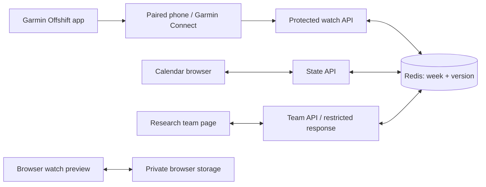

[Home](https://github.com/AndhikaNayakaAW/DECO2850-team-project/wiki) · [Get started](https://github.com/AndhikaNayakaAW/DECO2850-team-project/wiki/Getting-Started) · [Design](https://github.com/AndhikaNayakaAW/DECO2850-team-project/wiki/Design-and-Research) · [Architecture](https://github.com/AndhikaNayakaAW/DECO2850-team-project/wiki/Architecture) · [Testing](https://github.com/AndhikaNayakaAW/DECO2850-team-project/wiki/Testing-and-TDD) · [Deployment](https://github.com/AndhikaNayakaAW/DECO2850-team-project/wiki/Deployment) · [Watch & reflection](https://github.com/AndhikaNayakaAW/DECO2850-team-project/wiki/Watch-and-Reflection) · [Weekly contribution](https://github.com/AndhikaNayakaAW/DECO2850-team-project/wiki/Weekly-Contribution)

# Architecture

Offshift has a Next.js calendar and a native Monkey C Garmin app. Both read and update one shared session through server APIs. The public deployment uses durable Redis storage; local development can use a JSON file.

## Shared session

Events have dates and a time zone, Australia/Brisbane by default. A session has shifts, university commitments, personal plans, offers, messages, settings and an optional wearable record. The browser merges edits against its last synchronized base. Redis uses compare-and-set writes and retries so concurrent instances do not silently overwrite the week. Duplicate answers cannot both accept the same ask.

| Boundary | Source | Responsibility |
| :--- | :--- | :--- |
| State and persistence | `offshift-phone/src/lib/server-state.ts` | Redis REST commands, versions and conflict retries. |
| Browser sync | `offshift-phone/src/lib/sync.tsx` | Polling, browser merges and session changes. |
| Watch API | `offshift-phone/src/app/api/watch/route.ts` | Summary, confirmed replies, optional health bands and sharing-off. |
| Garmin mapping | `offshift-phone/src/lib/garmin.ts` | Words and watch-sized summaries. |
| Team API | `offshift-phone/src/app/api/team/route.ts` | Research session controls and restricted projection. |
| Native watch | `offshift-watch/source` | Circular pages, answer confirmation, sensors and serial requests. |
| Release builder | `offshift-watch/scripts/build.mjs` | Validate HTTPS and privately embed the deployment endpoint. |

## Native watch flow

The foreground app polls every five seconds and reads sensors roughly once a minute. With consent, changed health bands are uploaded, with a periodic refresh. A five-minute background request is registered with Garmin; actual background delivery is subject to the watch operating system. Requests run serially so polling does not collide with a reply.

The native release embeds the Vercel endpoint in a temporary source copy. Retained settings from an older sideload cannot redirect it to a laptop. A protected release includes the access code only in its private build artifact. The key, code, Redis credentials and binary are excluded from Git.

The intended deployed route is watch → Garmin Connect on the paired phone → internet → Vercel → Redis. The laptop is needed for development and sideload installation, not for the server once installed. The phone must still be paired and able to provide the communication bridge.

## Two data paths

Native body data belongs to the shared session as timestamped bands and is displayed by the calendar. Raw sensor values remain on the watch. The `/team` response omits body data and private plans. However, this is a shared-code prototype: it does not implement separate employer and worker API roles or separate accounts.

The `/watch` browser preview has a different file-import path. Its numeric readings, written reflections and recovery blocks use private browser storage, scoped to the current session. Demo data is loaded explicitly; imported origin is self-reported and unverified. Those local records do not become a live Garmin feed.

## Evidence boundary

The 20 October physical test verified fresh production contact, a synthetic request on the watch, one confirmed acceptance, one resulting calendar shift and delivery of available Garmin bands. Synthetic artifacts were removed while preserving the session and wearable record. The corrected release was transferred with an exact readback hash; its owner-reported Synced display and post-transfer server observation are recorded separately. Simulator images are not physical-watch captures. See the [contribution record](Weekly-Contribution).
