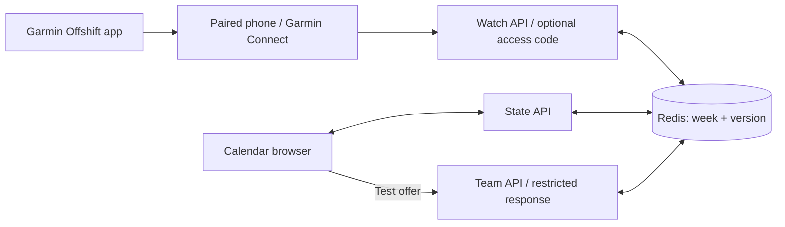

[Home](https://github.com/AndhikaNayakaAW/DECO2850-team-project/wiki) · [Get started](https://github.com/AndhikaNayakaAW/DECO2850-team-project/wiki/Getting-Started) · [Design](https://github.com/AndhikaNayakaAW/DECO2850-team-project/wiki/Design-and-Research) · [Architecture](https://github.com/AndhikaNayakaAW/DECO2850-team-project/wiki/Architecture) · [Testing](https://github.com/AndhikaNayakaAW/DECO2850-team-project/wiki/Testing-and-TDD) · [Deployment](https://github.com/AndhikaNayakaAW/DECO2850-team-project/wiki/Deployment) · [Watch & reflection](https://github.com/AndhikaNayakaAW/DECO2850-team-project/wiki/Watch-and-Reflection) · [Weekly contribution](https://github.com/AndhikaNayakaAW/DECO2850-team-project/wiki/Weekly-Contribution)

# Architecture

Offshift has a Next.js calendar and a native Monkey C Garmin app. Both read and update one shared session through server APIs. The public deployment uses durable Redis storage; local development can use a JSON file.

## Shared session

Events have dates and a time zone, Australia/Brisbane by default. A session has shifts, university commitments, personal plans, offers, messages, sync logs and settings. Each shift can carry one work rating and optional stress/heart levels. The browser merges edits against its last synchronized base. Redis uses compare-and-set writes and retries so concurrent instances do not silently overwrite the week. Duplicate answers cannot both accept the same ask.

| Boundary | Source | Responsibility |
| :--- | :--- | :--- |
| State and persistence | `offshift-phone/src/lib/server-state.ts` | Redis REST commands, versions and conflict retries. |
| Browser sync | `offshift-phone/src/lib/sync.tsx` | Polling, browser merges and session changes. |
| Watch API | `offshift-phone/src/app/api/watch/route.ts` | Summary, answers, post-shift ratings, shift readings and sharing-off. |
| Garmin mapping | `offshift-phone/src/lib/garmin.ts` | Words and watch-sized summaries. |
| Shift readings | `offshift-phone/src/lib/shift-body.ts` | Parse levels, validate shift windows, store readings and record private refusal reasons. |
| Shift check-in | `offshift-phone/src/lib/effort.ts` | Identify a completed shift and store its one work rating. |
| Past shifts | `offshift-phone/src/lib/past-shifts.ts` | Compare recent finished shifts at the ask's workplace. |
| Team API | `offshift-phone/src/app/api/team/route.ts` | Asks from the calendar's Test offer, and the restricted projection. |
| Native watch | `offshift-watch/source` | Circular pages, answer confirmation, sensors and serial requests. |
| Release builder | `offshift-watch/scripts/build.mjs` | Validate HTTPS and privately embed the deployment endpoint. |

## Native watch flow

The foreground app polls every five seconds. About 15 minutes after a shift ends, the summary offers a check-in and, with sharing enabled, a window for reading that shift's sensor history. A five-minute background request is registered with Garmin; actual background delivery is subject to the watch operating system. Requests run serially so polling does not collide with an answer or upload.

Each signal is sent as text, one character per quarter hour: `0`–`3` for a level and `-` for no reading. The server also accepts lists. It verifies that the shift exists, has finished, still has the same time window and has matching block counts. Refusals are logged privately. Duplicate readings do not add another read log; permanently refused uploads stop retrying, while connection failures back off. The watch shows the last send result. Turning sharing off is retried until deletion is confirmed, and repeated if readings reappear.

The native release embeds the Vercel endpoint in a temporary source copy. Retained settings from an older sideload cannot redirect it to a laptop. A protected release includes the access code only in its private build artifact. The key, code, Redis credentials and binary are excluded from Git.

The intended deployed route is watch → Garmin Connect on the paired phone → internet → Vercel → Redis. The laptop is needed for development and sideload installation, not for the server once installed. The phone must still be paired and able to provide the communication bridge.

## Body data

Native body data belongs to the shared session as levels on each shift: one 0–3 level per 15 minutes for stress and for heart rate, read by the watch after the shift ends and only while the worker shares. Raw sensor values remain on the watch, and nothing outside a shift is read. The `/api/team` response omits shifts, ratings, readings and private plans. The public prototype currently opens without a code; optional shared-code access does not implement separate employer and worker API roles or accounts.

The earlier `/watch` browser preview kept file-imported readings and reflections in private browser storage. It was removed on 23 Oct 2026, and the calendar now deletes that storage when it opens.

## Evidence boundary

The 20 October physical test verified fresh production contact, a synthetic request on the watch, one confirmed acceptance, one resulting calendar shift and delivery of available Garmin bands. Synthetic artifacts were removed while preserving the session and wearable record. The corrected release was transferred with an exact readback hash; its owner-reported Synced display and post-transfer server observation are recorded separately. Simulator images are not physical-watch captures. See the [contribution record](Weekly-Contribution).
