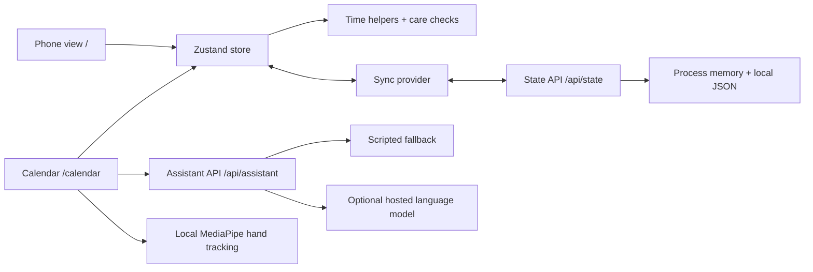

[Home](https://github.com/AndhikaNayakaAW/DECO2850-team-project/wiki) · [Get started](https://github.com/AndhikaNayakaAW/DECO2850-team-project/wiki/Getting-Started) · [Design](https://github.com/AndhikaNayakaAW/DECO2850-team-project/wiki/Design-and-Research) · [Architecture](https://github.com/AndhikaNayakaAW/DECO2850-team-project/wiki/Architecture) · [Testing](https://github.com/AndhikaNayakaAW/DECO2850-team-project/wiki/Testing-and-TDD) · [Deployment](https://github.com/AndhikaNayakaAW/DECO2850-team-project/wiki/Deployment)

# Architecture

Offshift is a Next.js application with a phone view and calendar view sharing one Zustand data store. Pure TypeScript helpers calculate the trade-offs; components handle presentation and interaction.

## Where to work

| Area | Source | Responsibility |
| :--- | :--- | :--- |
| Domain types | [`types.ts`](https://github.com/AndhikaNayakaAW/DECO2850-team-project/blob/main/offshift-phone/src/lib/types.ts) | Shifts, offers, plans, messages and settings. |
| Scenario | [`scenario.ts`](https://github.com/AndhikaNayakaAW/DECO2850-team-project/blob/main/offshift-phone/src/lib/scenario.ts) | Fixed clock and fictional demonstration data. |
| Time calculations | [`logic.ts`](https://github.com/AndhikaNayakaAW/DECO2850-team-project/blob/main/offshift-phone/src/lib/logic.ts) | Paid time, income, overlaps, travel buffers and rest windows. |
| Care checks | [`checks.ts`](https://github.com/AndhikaNayakaAW/DECO2850-team-project/blob/main/offshift-phone/src/lib/checks.ts) | Body / Week / Money, alternatives and reply drafts. |
| Store | [`store.ts`](https://github.com/AndhikaNayakaAW/DECO2850-team-project/blob/main/offshift-phone/src/lib/store.ts) | State, persistence, offer responses and reset actions. |
| Cross-device sync | [`sync.tsx`](https://github.com/AndhikaNayakaAW/DECO2850-team-project/blob/main/offshift-phone/src/lib/sync.tsx) | Debounced writes and one-second polling. |
| Board | [Calendar components](https://github.com/AndhikaNayakaAW/DECO2850-team-project/tree/main/offshift-phone/src/components/board) | Three.js scene, immersive controls and assistant UI. |
| Gestures | [`gestures.ts`](https://github.com/AndhikaNayakaAW/DECO2850-team-project/blob/main/offshift-phone/src/lib/gestures.ts) | Pure gesture-state engine tested separately from the camera. |
| Hand input | [`hands.ts`](https://github.com/AndhikaNayakaAW/DECO2850-team-project/blob/main/offshift-phone/src/lib/hands.ts) | MediaPipe landmarks and browser camera processing. |

## State and sync

The store separates scenario data from UI state such as which app or sheet is open. `pickData` selects the shared data. Browser persistence uses localStorage when available and falls back to memory when it is unavailable.

Changes queue a write after 150 ms. Other clients poll `/api/state` roughly once a second. The route tracks a version and client ID, keeps data in process memory, and attempts to write a JSON file. This is prototype synchronization: there is no transactional merge, authentication or per-user isolation.

## Time model

The scenario uses weekday labels and 24-hour clock strings, rather than dated, timezone-aware events. An end clock earlier than the start means the next day. Equal clocks mean an empty interval. Touching endpoints do not overlap.

`shiftImpact` compares dated intervals within the scenario week and accounts for adjacent-day events. When a Sunday shift crosses midnight, Monday commitments are treated as the next weekly occurrence. The calendar rendering and every higher-level narrative are not a complete overnight scheduling system; the regression change specifically covers the shared time calculations.

## Assistant and camera

`/api/assistant` uses an optional hosted language model when server credentials are present and falls back to scripted responses. It returns speech text and structured actions; the client applies those actions to the scenario. This does not connect to a real employer messaging service.

Hand and face-presence processing runs in the browser with locally served model files. Presence detection does not identify a person. The optional hosted assistant is a separate data path and receives scenario context.

**Next:** [Test behaviour before changing it](https://github.com/AndhikaNayakaAW/DECO2850-team-project/wiki/Testing-and-TDD).
