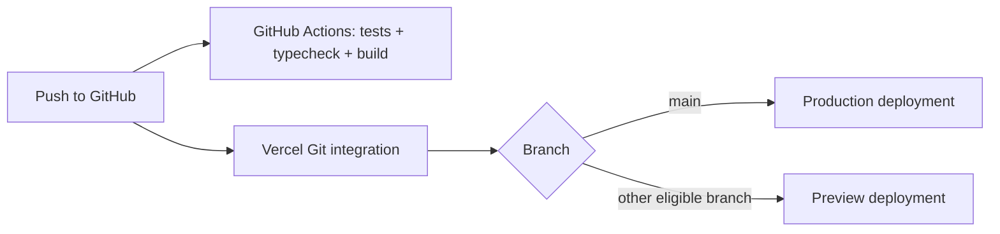

[Home](https://github.com/AndhikaNayakaAW/DECO2850-team-project/wiki) · [Get started](https://github.com/AndhikaNayakaAW/DECO2850-team-project/wiki/Getting-Started) · [Design](https://github.com/AndhikaNayakaAW/DECO2850-team-project/wiki/Design-and-Research) · [Architecture](https://github.com/AndhikaNayakaAW/DECO2850-team-project/wiki/Architecture) · [Testing](https://github.com/AndhikaNayakaAW/DECO2850-team-project/wiki/Testing-and-TDD) · [Deployment](https://github.com/AndhikaNayakaAW/DECO2850-team-project/wiki/Deployment) · [Watch & reflection](https://github.com/AndhikaNayakaAW/DECO2850-team-project/wiki/Watch-and-Reflection) · [Weekly contribution](https://github.com/AndhikaNayakaAW/DECO2850-team-project/wiki/Weekly-Contribution)

# Deployment

The repository documents a Vercel project for the phone and calendar prototype.

**[Watch preview ↗](https://offshift-nine.vercel.app/watch)** · **[Phone demo ↗](https://offshift-nine.vercel.app/)** · **[Calendar ↗](https://offshift-nine.vercel.app/calendar)** · **[Exhibition view ↗](https://offshift-nine.vercel.app/calendar?immersive=1)**

## Project configuration

| Setting | Value |
| :--- | :--- |
| Vercel project | `offshift` |
| Scope | `andhikanayakaaws-projects` |
| Root directory | `offshift-phone` |
| Framework | Next.js |
| Production branch | `main` |

The [repository README](https://github.com/AndhikaNayakaAW/DECO2850-team-project/blob/main/README.md) records the project IDs and original deployment details. Check the Vercel dashboard for the current deployment status.

## Before a release

```bash
cd offshift-phone
npm ci
npm test
npm run typecheck
npm run build
```

Then inspect `/watch`, the daily `/calendar`, the optional `/calendar?view=3d`, the immersive view, and Reset. The watch preview has its own private-data deletion control. Verify cross-device changes on the intended exhibition network. A push to `main` is documented as triggering a production deployment through the existing Vercel connection.

For a manual deployment, an authorised project member can use:

```bash
npm install --global vercel
cd offshift-phone
vercel login
vercel link --yes --project offshift --scope andhikanayakaaws-projects
vercel deploy --prod
```

## Configuration and limits

| Item | Behaviour |
| :--- | :--- |
| Assistant credentials | Optional server credentials enable the hosted assistant. Without them, scripted replies keep the demo usable. |
| `OFFSHIFT_STATE_FILE` | Optional server path override for the shared-state JSON file. |
| State persistence | Process memory and local files can disappear or diverge across serverless instances. |
| Access control | The shared-state API has no authentication or per-user isolation. Use fictional demo data. |
| State conflicts | Version/client tracking is not transactional conflict resolution. |
| Camera | Browser processing uses bundled MediaPipe models; user consent is still required. |

Keep credentials in the hosting platform or local environment files. Never place keys in source files, commits or wiki pages.

## Existing build warning

Turbopack reports broad filesystem tracing for the dynamic state-file path in `/api/state`. The production build succeeds, but the traced server bundle can be larger than intended. This warning predates the overnight-shift change.

Durable storage, authenticated sessions, per-user isolation and an explicit privacy review are needed before the prototype is used with real worker data.

## Verified Git push workflow

The existing Vercel project links to `AndhikaNayakaAW/DECO2850-team-project`, uses `main` as its production branch, and builds `offshift-phone`. This link was inspected through the authenticated Vercel API. The prior main commit also had a successful Vercel deployment status.

`offshift-phone/vercel.json` explicitly enables Git deployments. Pushes to `main` deploy production; other eligible Git branches can produce previews under the project's existing settings. No deployment tokens are committed. GitHub Actions separately validates the source using `.github/workflows/validate.yml`.



Merging the teammate's Garmin code into `main` will trigger this same integration if those project settings remain enabled. The native watch app still needs its own Garmin build/install workflow; Vercel redeploys the web app.

## Observed watch release

On 15 October 2026, a push of [`c2c0e15`](https://github.com/AndhikaNayakaAW/DECO2850-team-project/commit/c2c0e15) automatically produced a successful [Vercel production deployment](https://vercel.com/andhikanayakaaws-projects/offshift/DsPgKyDv9n9NS6ZbZ3XqUxhLngVa). The [GitHub validation run](https://github.com/AndhikaNayakaAW/DECO2850-team-project/actions/runs/38673040152) also completed successfully, including the 67-test suite, TypeScript, the production build and the standalone prototype check. The public watch, daily calendar and optional 3D routes returned HTTP 200.
